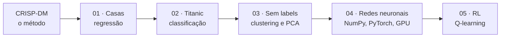

# Lição 02 · Machine Learning: fundamentos

**Dos dados à decisão: CRISP-DM, aprendizagem supervisionada e não supervisionada, redes neuronais e reinforcement learning.** Faz parte de [The AI Learning Hub](https://github.com/the-ai-learning-hub).

📖 **[Abrir os slides da Lição 02](https://the-ai-learning-hub.github.io/02-machine-learning-fundamentals/)** · usa ← → para mudar de slide, `F` para ecrã inteiro e `N` para as notas do orador.

Esta lição mostra o que é Machine Learning, como se organiza um projeto real com **CRISP-DM** e como funcionam as quatro famílias de algoritmos. Tem duas partes: os **slides** explicam cada ideia com um exemplo visual e sete demonstrações interativas, e **cinco notebooks** permitem correr o código, discutir os resultados e praticar com exercícios com solução escondida.

**Pré-requisitos:** [Lição 01 · Python: primeiros passos](https://github.com/the-ai-learning-hub/01-python-as-ai-first-steps) (pandas e gráficos). Não precisas de saber matemática avançada: as fórmulas aparecem sempre com números.

---

## O percurso



| # | Notebook | A pergunta | Slides | Abrir | Tempo |
|---|---|---|---|---|---|
| 01 | [CRISP-DM: preços de casas](01_supervised_learning/notebooks/01_CRISP-DM_House_Prices.ipynb) | Que fatores mais pesam no preço de uma casa? | [#supervisionada](https://the-ai-learning-hub.github.io/02-machine-learning-fundamentals/#supervisionada) | [](https://colab.research.google.com/github/the-ai-learning-hub/02-machine-learning-fundamentals/blob/main/01_supervised_learning/notebooks/01_CRISP-DM_House_Prices.ipynb) | 45 min |
| 02 | [CRISP-DM: sobreviventes do Titanic](01_supervised_learning/notebooks/02_CRISP-DM_Titanic_Survival.ipynb) | Que tipo de pessoa sobrevive? | [#metricas](https://the-ai-learning-hub.github.io/02-machine-learning-fundamentals/#metricas) | [](https://colab.research.google.com/github/the-ai-learning-hub/02-machine-learning-fundamentals/blob/main/01_supervised_learning/notebooks/02_CRISP-DM_Titanic_Survival.ipynb) | 45 min |
| 03 | [Aprendizagem não supervisionada](02_unsupervised_learning/notebooks/03_Unsupervised_Learning.ipynb) | Que estrutura existe sem labels? | [#nao-supervisionada](https://the-ai-learning-hub.github.io/02-machine-learning-fundamentals/#nao-supervisionada) | [](https://colab.research.google.com/github/the-ai-learning-hub/02-machine-learning-fundamentals/blob/main/02_unsupervised_learning/notebooks/03_Unsupervised_Learning.ipynb) | 25 min |
| 04 | [Redes neuronais de raiz](03_neural_networks/notebooks/04_Neural_Networks_From_Scratch.ipynb) | O que acontece dentro da caixa-preta? | [#redes-neuronais](https://the-ai-learning-hub.github.io/02-machine-learning-fundamentals/#redes-neuronais) | [](https://colab.research.google.com/github/the-ai-learning-hub/02-machine-learning-fundamentals/blob/main/03_neural_networks/notebooks/04_Neural_Networks_From_Scratch.ipynb) | 30 min |
| 05 | [Projeto de reinforcement learning](04_reinforcement_learning/notebooks/05_Reinforcement_Learning_Project.ipynb) | Como aprende um agente por tentativa e erro? | [#rl](https://the-ai-learning-hub.github.io/02-machine-learning-fundamentals/#rl) | [](https://colab.research.google.com/github/the-ai-learning-hub/02-machine-learning-fundamentals/blob/main/04_reinforcement_learning/notebooks/05_Reinforcement_Learning_Project.ipynb) | 30 min |

### Plano da aula (≈ 6 h, duas sessões de 3 h)

| Sessão | Bloco | Slides | Prática |
|---|---|---|---|
| 1 | Abertura: o que é ML, história, as 3 famílias | 15 min | — |
| 1 | CRISP-DM: as seis fases e o ciclo | 10 min | — |
| 1 | Preparação de dados: tipos, valores em falta e imputação, *outliers*, *encoding*, escala, validação, *leakage* | 30 min | — |
| 1 | Aprendizagem supervisionada: os dados, métricas de regressão e classificação, *threshold* | 25 min | Notebook 01 · 45 min |
| 1 | Modelos supervisionados: linear, Ridge, logística, árvores, *ensembles*, desequilíbrio, viés-variância | 25 min | Notebook 02 · 45 min |
| 2 | Não supervisionada: K-Means, DBSCAN, PCA | 20 min | Notebook 03 · 25 min |
| 2 | Redes neuronais: neurónio, XOR, *backprop*, PyTorch · CPU vs GPU | 40 min | Notebook 04 · 30 min |
| 2 | Reinforcement learning: MDP, Q-learning, *reward hacking* | 25 min | Notebook 05 · 30 min |
| 2 | Escolher o modelo, produção, ética e fecho | 35 min | — |

## O que vais saber fazer

- Organizar um projeto de ML com as seis fases do **CRISP-DM**, fazendo as perguntas certas em cada uma.
- Preparar dados sem **fugas de informação** (*data leakage*): `Pipeline`, `ColumnTransformer`, divisão treino/teste e validação cruzada.
- Treinar e comparar modelos de **regressão** e **classificação** contra um *baseline*, e escolher a **métrica** e o **threshold** certos para a decisão.
- Encontrar estrutura em dados sem labels com **K-Means**, **DBSCAN** e **PCA**, e saber avaliar o resultado.
- Explicar como uma **rede neuronal** aprende (*forward*, *loss*, gradiente, *backprop*), escrevê-la em NumPy e em PyTorch e medir quando uma **GPU** compensa.
- Treinar um agente de **Q-learning** num gridworld, avaliá-lo corretamente e reconhecer *reward hacking*.
- Pensar em produção (*drift*, monitorização, reprodutibilidade) e nos limites éticos de um modelo.

## Como começar

Precisas do que instalaste na [Lição 00](https://github.com/the-ai-learning-hub/00-environment-setup): **uv**, **VS Code** (com as extensões Python e Jupyter) e **Git**.

```bash
git clone https://github.com/the-ai-learning-hub/02-machine-learning-fundamentals.git
cd 02-machine-learning-fundamentals
uv sync
code .
```

`uv sync` instala o Python 3.12 e todas as bibliotecas desta lição (numpy, pandas, scikit-learn, matplotlib, seaborn, PyTorch…) num `.venv` local, com as versões exatas de `uv.lock`.

No VS Code, abre um notebook, clica em **Select Kernel** → **Python Environments** → **.venv** e corre as células por ordem com `Shift` + `Enter`.

> **Sem instalar nada?** Cada notebook tem um botão **Abrir no Colab**. A primeira célula clona este repositório no Colab, por isso os dados e o código partilhado (`src/`) ficam disponíveis automaticamente.

> **GPU (opcional):** só a Parte 3 do notebook 04 tira partido de uma GPU. Sem GPU, o notebook corre na CPU e explica o que mudaria. No Colab: *Runtime → Change runtime type → GPU*. Localmente, o `uv sync` instala o PyTorch para CPU (download pequeno). Para usar uma GPU NVIDIA, depois do `uv sync` corre:
>
> ```bash
> uv pip install torch --index-url https://download.pytorch.org/whl/cu128
> ```
>
> (escolhe a versão CUDA certa em [pytorch.org/get-started](https://pytorch.org/get-started/locally/)). Atenção: um `uv sync` posterior volta a pôr a versão CPU.

Cada notebook corre do início ao fim em menos de um minuto num portátil (tempos na [secção de verificação](#verificação)).

## Organização do repositório

```
02-machine-learning-fundamentals/
├── index.html                    ← slides (GitHub Pages)
├── README.md · LICENSE · .gitignore · .nojekyll
├── pyproject.toml · uv.lock      ← dependências (uv) de todos os notebooks
├── data/
│   └── DATA_DICTIONARY.md        ← fontes, licenças e variáveis
├── src/                          ← código partilhado pelos notebooks
│   ├── paths.py · data.py        ← encontrar a raiz e carregar os dados
│   ├── preprocessing.py          ← features e pipelines (sem leakage)
│   ├── metrics.py                ← matriz de confusão e threshold por custo
│   ├── plotting.py               ← estilo dos gráficos (paleta Okabe–Ito)
│   ├── nn_numpy.py               ← rede neuronal em NumPy + gradient check
│   ├── benchmark.py              ← benchmark CPU vs GPU (PyTorch)
│   ├── rl_utils.py               ← gridworld e Q-learning
│   └── tests/                    ← testes mínimos (pytest)
├── 01_supervised_learning/       ← notebooks 01 (casas) e 02 (Titanic)
├── 02_unsupervised_learning/     ← notebook 03
├── 03_neural_networks/           ← notebook 04
└── 04_reinforcement_learning/    ← notebook 05
```

Cada pasta temática tem um `README.md` com objetivos, pré-requisitos, tempo e link para o Colab.

## Como funcionam os notebooks

Todos seguem a mesma estrutura, guiada pelo **CRISP-DM**:

1. **🎯 Objetivos**, duração, pré-requisitos e **📑 índice**.
2. Uma secção por fase do CRISP-DM: explicação curta → código que corre → **💬 Discussão**. As discussões são perguntas abertas para parar e pensar em grupo; a **resposta-guia** para o instrutor está escondida num bloco que se abre com um clique.
3. **✏️ Exercícios** de ⭐ a ⭐⭐⭐ com **💡 Ver solução**.
4. **📌 Resumo**, **📚 Para saber mais** e links para o notebook anterior e o seguinte.

## Verificação

Execução completa de cada notebook num ambiente limpo criado com `uv sync` (Windows 11, Python 3.12, AMD Ryzen 7 7735HS, só CPU):

| Notebook | Tempo |
|---|---|
| 01 · Casas | 16 s |
| 02 · Titanic (inclui o download do `titanic3`) | 15 s |
| 03 · Não supervisionada | 10 s |
| 04 · Redes neuronais (CPU; com GPU a Parte 3 compara os dois) | 42 s |
| 05 · Reinforcement learning | 11 s |


```bash
uv run pytest -q                       # testes do código partilhado (src/tests)
uv run python -m http.server 8000      # servir os slides em http://localhost:8000
```

## Dados

Ver [`data/DATA_DICTIONARY.md`](data/DATA_DICTIONARY.md). Os dados **não estão no repositório**: o código descarrega-os das **fontes oficiais** sempre que um notebook corre — as casas de Windsor (1987) do arquivo do *Journal of Applied Econometrics* (Anglin & Gençay, 1996) e o Titanic (`titanic3`) da Vanderbilt University (Harrell & Cason) — diretamente para a memória: nenhum ficheiro de dados fica no projeto.

## Para saber mais

- Chapman, P. et al. (2000). *CRISP-DM 1.0: Step-by-step data mining guide*.
- [scikit-learn User Guide](https://scikit-learn.org/stable/user_guide.html) · [Common pitfalls](https://scikit-learn.org/stable/common_pitfalls.html) · [Choosing the right estimator](https://scikit-learn.org/stable/machine_learning_map.html)
- Sutton, R. S. & Barto, A. G. (2018). [*Reinforcement Learning: An Introduction*](http://incompleteideas.net/book/the-book-2nd.html), 2.ª ed.
- Goodfellow, I., Bengio, Y. & Courville, A. (2016). [*Deep Learning*](https://www.deeplearningbook.org).
- [PyTorch — Learn the Basics](https://docs.pytorch.org/tutorials/beginner/basics/intro.html)

---

**The AI Learning Hub** · Lição 02 — Machine Learning: fundamentos · Diogo Freitas & João Francisco Botas · [Licença MIT](LICENSE). Os dados pertencem às respetivas fontes (ver o dicionário de dados).
